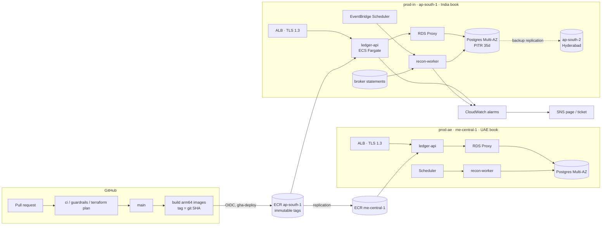

# LedgerOps Platform

[](https://github.com/Neal006/ledgerops-platform/actions/workflows/ci.yml)
[](https://github.com/Neal006/ledgerops-platform/actions/workflows/guardrails.yml)
[](https://github.com/Neal006/ledgerops-platform/actions/workflows/terraform.yml)

Platform engineering for a regulated, **multi-jurisdiction fintech ledger**: everything needed to
take a double-entry ledger from pull request to production on AWS and know that it's healthy.

The applications are deliberately small. The point is the platform around them:

- **Two regulated books in two regions.** India (IFSCA / GIFT City) runs in `ap-south-1` and the UAE
  in `me-central-1`, as fully separate stacks with in-jurisdiction backups.
- **CI/CD** on GitHub Actions for a Turborepo/pnpm + Python monorepo, with OIDC to AWS (no stored
  keys), build-once/promote-everywhere images, gated production approvals, and one-command rollback.
- **Migration safety**: an advisory-locked migrator with fail-fast lock timeouts, expand/contract
  enforcement in CI, and migrations that run *before* rollout so a bad one can't take an
  environment down.
- **Infrastructure as code**: Terraform modules for VPC, ECS Fargate, ALB/TLS, RDS Postgres + RDS Proxy,
  ECR replication, EventBridge Scheduler, CloudWatch alarms, and least-privilege IAM.
- **Observability**: Prometheus metrics, SLOs with multi-window burn-rate alerts, a dead man's
  switch for the daily reconciliation, runbooks and a blameless postmortem process.

> **Status:** a reference implementation built as a portfolio project. All Terraform passes
> `terraform validate` against AWS provider 6.x. The ledger API and recon worker are tested
> (unit tests locally, Postgres integration tests in CI). It hasn't run real client money.

---

## Architecture



Each environment's VPC has three subnet tiers: **public** (ALB and NAT only), **private** (tasks,
with ECR/Secrets Manager/Logs/STS reached over VPC endpoints) and **database** (no route to the
internet in either direction).

## Repository layout

```
apps/
  ledger-api/          TypeScript · Fastify double-entry ledger, migrator, Prometheus metrics
  recon-worker/        Python · daily ledger-vs-broker reconciliation, CloudWatch EMF metrics
infra/terraform/
  bootstrap/           state bucket (S3 native locking) + GitHub OIDC provider and CI roles
  modules/             network · rds-postgres · ecs-service · scheduled-task · observability · platform
  live/                global (ECR) · staging · prod-in · prod-ae
observability/         Prometheus rules (SLOs), Alertmanager, Grafana dashboards (local stack)
scripts/               deploy · rollback · restore-drill · check-migrations · seed-local
docs/                  SLOs · incident process · postmortem template · runbooks
.github/workflows/     ci · guardrails · terraform · deploy · rollback
```

## Quick start (local)

Requirements: Docker, Node 22 + pnpm 10, [uv](https://docs.astral.sh/uv/).

```bash
make install     # pnpm + uv dependencies
make up          # Postgres → migrations → API, plus Prometheus, Alertmanager, Grafana
make seed        # create accounts and post a balanced deposit
make recon       # run one reconciliation pass against the sample broker statement
make test lint   # the same gates CI runs
```

| URL | What |
|---|---|
| http://localhost:3000/v1/accounts/balances | Ledger API |
| http://localhost:3001 | Grafana: *Ledger API, SLOs and health* |
| http://localhost:9090/alerts | Prometheus alert rules |

```bash
curl -X POST localhost:3000/v1/journal-entries -H 'content-type: application/json' -d '{
  "idempotency_key": "deposit-0002", "description": "client deposit",
  "occurred_at": "2026-10-02T10:00:00Z",
  "postings": [
    {"account_code": "BROKER:ALPACA:USD", "amount_minor": "5000",  "currency": "USD"},
    {"account_code": "CLIENT:1001:USD",   "amount_minor": "-5000", "currency": "USD"}
  ]}'
```

## How a change reaches production

1. **Pull request.** `ci` runs lint, typecheck and tests (Postgres service container) with a
   cached Turborepo pipeline and only rebuilds what changed. `guardrails` runs the migration
   safety gate, squawk SQL lint, gitleaks, and Trivy IaC/dependency scans. `terraform` posts a
   read-only plan for every stack as a PR comment.
2. **Merge to `main`.** Images are built once for `linux/arm64`, tagged with the git SHA in an
   immutable ECR repo, and pushed with SBOM and provenance attestations.
3. **Staging**, then **prod-in**, then **prod-ae** (one jurisdiction at a time, each behind a
   GitHub environment approval). [`scripts/deploy.sh`](scripts/deploy.sh) does the following:
   - registers new task definition revisions pointing at the immutable SHA-tagged image
   - runs migrations as a one-off Fargate task against the direct DB endpoint. **If that fails, the
     service is never touched.**
   - rolls the service: min 100% / max 200%, with the ECS **circuit breaker** and **CloudWatch
     alarm** rollback watching it
   - smoke-tests through the public ALB and rolls back automatically on failure
4. **Rollback** at any time: `make rollback ENV=prod-in`, or the *rollback* workflow (which records a
   reason). Because migrations are expand-only, the previous version always runs on the current schema.

## Design decisions

| Decision | Why |
|---|---|
| **Stacks per jurisdiction, not one multi-region stack** | Data residency. The IN and AE books share no database, bucket or state file. IN backups replicate to Hyderabad (still India); AE has no cross-region copy because the only other nearby region is outside the UAE. |
| **Double-entry enforced in the database too** | A deferred constraint trigger rejects any commit where a journal entry doesn't net to zero per currency, and the ledger tables are append-only. Even a buggy code path or a manual `psql` session can't unbalance the books. |
| **Idempotency keys with request hashing** | Retries from brokers and mobile clients are safe. Reusing a key with a different payload returns `409` instead of silently returning the old entry. |
| **Migrations before rollout, through the direct endpoint** | Session-level advisory locks would pin RDS Proxy connections. `lock_timeout = 5s` makes a blocked migration fail fast instead of queueing all traffic behind its lock. |
| **OIDC roles pinned to GitHub environments** | `gha-deploy` and `gha-terraform-apply` can only be assumed by jobs in protected environments, so approval rules are enforced by AWS IAM, not just the GitHub UI. |
| **RDS-managed master secret** | The password is generated and rotated by RDS, injected into tasks by the ECS agent, and never appears in Terraform state, CI or source. |
| **EMF for batch metrics** | The recon job writes one structured log line and CloudWatch turns it into metrics. No SDK, no extra IAM. The "stale" alarm treats missing data as breaching: a dead man's switch. |
| **Symptom-based alerting** | Pages are for SLO burn and money at risk. CPU and connection counts go to tickets and dashboards. See [docs/slos.md](docs/slos.md). |
| **Guardrail against prod data locally** | `APP_ENV=local` refuses to connect to any `*.rds.amazonaws.com` host. |

## Operations

- [SLOs and alerting policy](docs/slos.md)
- [Incident process](docs/incident-process.md) · [Postmortem template](docs/postmortem-template.md)
- Runbooks: [error rate](docs/runbooks/high-error-rate.md) ·
  [latency](docs/runbooks/high-latency.md) ·
  [DB connection exhaustion](docs/runbooks/db-connection-exhaustion.md) ·
  [recon breaks](docs/runbooks/recon-breaks.md) ·
  [migration failure](docs/runbooks/migration-failure.md) ·
  [backup and restore](docs/runbooks/backup-restore.md)

## Deploying it yourself

```bash
cd infra/terraform/bootstrap && terraform init && terraform apply     # state bucket + OIDC roles
# set repo variable AWS_ACCOUNT_ID; create GitHub environments staging, production-in, production-ae
cd ../live/global && terraform init -backend-config=bucket=ledgerops-tfstate-<account> && terraform apply
# push an initial image tagged "bootstrap", fill in terraform.tfvars, then apply staging / prod-in / prod-ae
```

Every workflow that touches AWS is skipped until `AWS_ACCOUNT_ID` is set, so forks run CI cleanly.

## Roadmap

- OpenTelemetry tracing (ADOT collector sidecar → X-Ray / Tempo) and Amazon Managed Prometheus
  scraping, so the local Prometheus SLO rules run unchanged in AWS
- AWS WAF on the ALBs, and ALB access logs to S3 with Object Lock for audit retention
- Per-PR ephemeral environments (ECS service per branch behind a host-header rule)
- Permissions boundary on the Terraform apply role
- ECS native blue/green with a bake period for the order-placement path

## License

[MIT](LICENSE)
